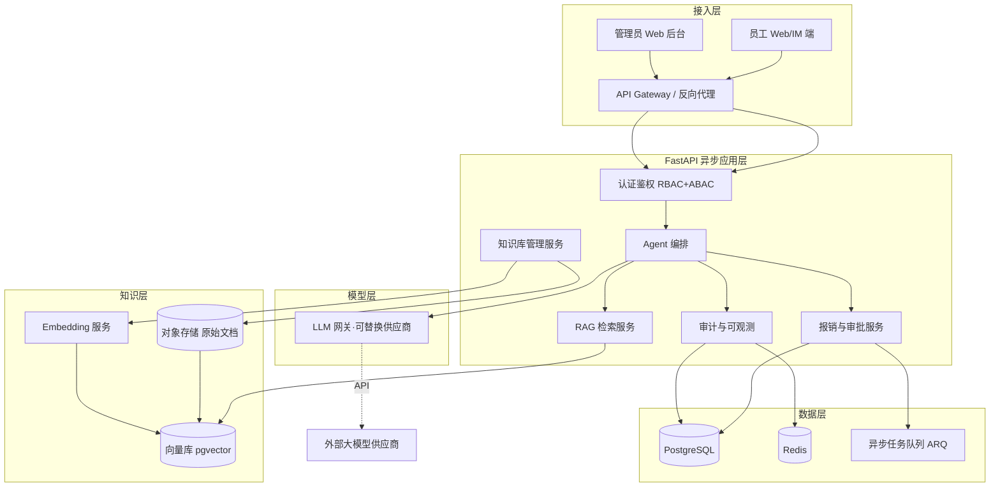
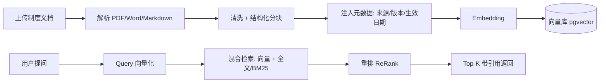

# 拾光连锁智能体系统 · 技术架构选型（V0.1）

> 角色：资深 Python 后端架构师
> 约束：FastAPI（异步）· Python 3.11+ · LLM 走 API 且可替换供应商 · 知识库为报销制度文档（差旅标准/发票规则/审批流程）并向量化检索 · 双角色（员工问答+发起报销 / 管理员维护知识库+看记录）
> 一致性说明：本设计承接《一页纸需求清单》的架构基线——混合云、RBAC+ABAC、可配置 BPM 审批、全链路可追溯、可替换模型。

---

## 1. 架构总览



**分层职责**
- **接入层**：员工端（问答 + 发起报销）、管理员端（知识库维护 + 记录查看）；统一经 API 网关做 TLS、限流、鉴权前置。
- **应用层**：FastAPI 路由 + 业务服务，核心是可替换的 Agent 编排与 RAG 流水线。
- **模型层**：LLM 网关对供应商做抽象，业务代码不感知具体厂商。
- **知识层 / 数据层**：制度文档向量化后入向量库，业务与审计数据入 PostgreSQL，会话/缓存/队列用 Redis。

---

## 2. 技术栈

| 关注点 | 选型 | 理由 |
|---|---|---|
| Web 框架 | **FastAPI + Uvicorn**，Python 3.11+ | 原生 async/await、Pydantic v2 校验、OpenAPI 自带文档 |
| 数据模型 | SQLAlchemy 2.0（async） + **asyncpg** | 异步驱动，避免阻塞事件循环 |
| 关系库 | **PostgreSQL 15+** | 稳定、JSONB 灵活、可复用 |
| 向量库 | **pgvector**（首选）/ Qdrant | 复用 Postgres 减运维；量大再切独立向量库 |
| 缓存/队列 | **Redis** + **ARQ**（或 Celery） | 会话、限流、嵌入批处理、审批超时检查 |
| HTTP 客户端 | **httpx**（异步） | 调用 LLM/外部 API，支持超时与重试 |
| 嵌入/重排 | 可替换 Embedding（云端 text-embedding 或本地 bge）+ cross-encoder 重排 | 检索质量与可替换性 |
| 认证 | JWT（PyJWT/python-jose）+ Argon2 密码哈希 | 双角色会话与凭证安全 |
| 可观测 | OpenTelemetry + Prometheus + 结构化日志 | 全链路 trace、指标、审计溯源 |
| 容器化 | Docker / docker-compose / K8s | 混合云部署，敏感数据本地 |

> 轻量优先：Agent 编排用自研薄编排（Planner→Retriever→Tool→Generator），仅在确需复杂状态机时引入 LangGraph，避免重依赖。

---

## 3. LLM 网关（可替换供应商）

业务侧只依赖 `LLMProvider` 协议，供应商通过配置切换，并支持降级链路。

```python
from typing import Protocol, AsyncIterator, List, Dict, Any

class LLMProvider(Protocol):
    name: str
    async def chat(self, messages: List[Dict[str, str]], **kw) -> str: ...
    async def stream(self, messages: List[Dict[str, str]], **kw) -> AsyncIterator[str]: ...

class OpenAICompatibleProvider:
    """通用于 OpenAI / DeepSeek / 智谱 / 通义等 OpenAI 兼容端点。"""
    def __init__(self, base_url: str, api_key: str, model: str, client: "httpx.AsyncClient"):
        self.name, self.base_url, self.api_key, self.model, self._client = \
            "openai-compatible", base_url, api_key, model, client

    async def chat(self, messages, **kw):
        r = await self._client.post(
            f"{self.base_url}/chat/completions",
            json={"model": self.model, "messages": messages, **kw},
            headers={"Authorization": f"Bearer {self.api_key}"},
            timeout=30,
        )
        r.raise_for_status()
        return r.json()["choices"][0]["message"]["content"]
    # stream() 同理，按 SSE 解析
```

**网关策略**
- `settings.LLM_PROVIDER` 决定主供应商；维护 `fallback_chain`（如 主→备→本地小模型）。
- 统一出入参、超时、重试、限流；请求/响应全程打 `trace_id` 进审计。
- 敏感语料（员工报销明细）默认不随提示词出域，呼应混合云与数据驻留约束。

---

## 4. 知识库（报销制度）RAG 流水线



- **解析**：`pdfplumber` / `python-docx` / `unstructured` 抽取文本与标题层级。
- **分块**：按标题语义切分（约 500–800 token，重叠 10–15%），保留章节上下文。
- **元数据**：每条 chunk 带 `doc_id / version / effective_date / section`，支撑"按版本选规则"与审计溯源。
- **检索**：向量召回 + 关键词（差旅标准、发票类型、审批额度等术语命中）混合，再 cross-encoder 重排取 Top-K。
- **版本化**：管理员上传即生成新版本，旧版本保留不可变；检索默认走"当前生效版本"，冲突时附两版本交人工（呼应审批流程）。

---

## 5. 双角色与业务流程

| 角色 | 能力 | 数据范围（ABAC） |
|---|---|---|
| 员工 | 制度问答（带引用）、发起报销、查询本人进度 | 仅本人报销单与记录 |
| 管理员 | 维护/版本化制度知识库、查看全量记录与审计、配置审批流 | 全量；可触发索引重建 |

**员工问答流**：登录 → 提问 → 鉴权 → Agent 检索知识库 → LLM 生成（附制度引用与版本）→ 落审计。
**发起报销流**：填单（项目/金额/发票类型）→ RAG 校验政策合规性（差旅标准、发票规则）→ 提交 → 进入审批工作流（可配置 BPM）→ 管理员/审批人处理 → 状态回写。
**知识库维护流**：管理员上传制度 → 解析分块嵌入 → 新版本生效 → 异步重建索引 → 旧版保留。

---

## 6. 审计与可观测（全链路可追溯）

- 每次请求生成 `trace_id`；记录：用户、角色、query、检索到的 chunk（doc_id+版本）、模型与版本、token、响应、引用、耗时、结果。
- 审计表 **append-only**（不可改、可重建单次处理），满足一致率验收与责任追溯。
- 错误/越权/转人工均留痕；敏感操作（删除/归档）单独标记。
- Prometheus 暴露 LLM 时延、检索命中率、报销单量；OTel 串联跨服务 trace。

---

## 7. 目录结构建议

```
app/
  main.py                 # FastAPI 入口
  core/
    config.py             # pydantic-settings，环境/密钥
    security.py           # JWT、密码哈希、RBAC/ABAC 依赖
    db.py                 # async engine/session
  llm/
    gateway.py            # LLMProvider 协议 + 网关
    providers.py          # OpenAI 兼容实现 + 降级链
  rag/
    ingest.py             # 解析/分块/嵌入
    retrieve.py           # 混合检索 + 重排
    store.py              # pgvector 读写
  agents/
    orchestrator.py       # Planner→Retriever→Tool→Generator
    tools.py              # 报销提交/查询/状态（经权限校验）
  services/
    reimbursement.py      # 报销与审批（BPM）
    kb.py                 # 知识库版本管理
    audit.py              # 审计写入
  api/
    auth.py chat.py reimbursement.py admin.py
  models/  schemas/        # SQLAlchemy / Pydantic
tests/
infra/
  Dockerfile  docker-compose.yml  k8s/
```

---

## 8. 部署与下一步

- **部署**：容器化；开发用 compose（FastAPI+Postgres+Redis+pgvector），生产用 K8s；敏感数据留本地、通用推理上云（混合云基线）。
- **配置**：供应商密钥、DB、Redis 经环境变量/Secret 注入，不入库。
- **关键待办**：① 选定向量库（pgvector 起步）；② 确定 Embedding 供应商与维度；③ 定义报销审批 BPM 字段与升级时限；④ 明确审计留存周期（默认 90 天）；⑤ 压测 LLM 并发与检索延迟。

> 本架构为选型草案（V0.1），下一步可据此产出接口契约（OpenAPI）、数据表结构与 MVP 任务拆解。
